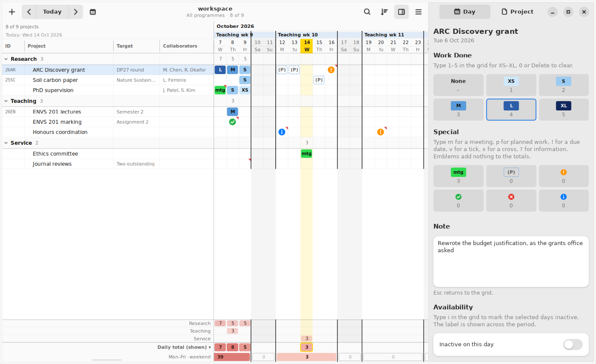

# QDVC Progress

Keep track of your projects and the work you put into them, day by day, in
one spreadsheet-like grid: a row per project, a column per day. Each day you
note how much a project took out of you — XS, S, M, L or XL — or that you
had a meeting about it, that something was due, or that you plan to work on
it. The totals at the bottom show your workload per day, per working week
and per weekend. A GNOME app built with GTK 4 and libadwaita.

Your data is a plain folder of small YAML and CSV files, one log file per
month, so it diffs cleanly and is easy to keep in Git. The format is
documented in [docs/FILE_FORMAT.md](docs/FILE_FORMAT.md), and is shared with
[QDVC Progress for macOS](https://github.com/qdvc-apps/qdvc-progress-mac):
the two editions can work on the same workspace.



## What it does

The window is the grid, with a side panel on its right (F9). The layout and
its precedents in GNOME Calendar, Files and LibreOffice Calc are explained
in [docs/DESIGN.md](docs/DESIGN.md).

- **Header:** the month and year, your own label for each week (a teaching
  week, a sprint, a holiday; unlabelled weeks show their week number), the
  day of the month and the day of the week (M, Tu, W, Th, Fr, Sa, Su).
  Today is highlighted in yellow, and each working week is outlined by a
  line down the left of Monday and the right of Friday. The header, the
  project columns and the totals stay put while the days scroll; scroll as
  far back or ahead as you like.
- **Projects** are grouped under their **programme of work** (click a
  programme heading to fold it). Each has a title and, optionally, an ID
  (such as 26XY), a target and collaborators. Click a column heading to sort
  by it; drag a heading's edge to resize it; right-click to show or hide
  columns.
- **Day cells** hold one label — **XS S M L XL** in a blue heat map from
  baby blue to navy, **mtg** in bright green, **(P)** for planned work, or
  an emblem: an amber **!** for a due date, a green **tick**, a red
  **cross** or a blue **i** for information — and an optional **note**,
  marked by a red corner as in a spreadsheet. Click a cell with a note to see
  it in a popover beside the cell, or rest the pointer on it. Days can be
  marked **inactive**, hatched, with a label shown across the period ("On
  hold", "With co-authors").
- **Totals** add up each day's labels (XS = 1 … XL = 5 by default; a meeting
  counts as M; emblems count 0) in a salmon-to-red heat map, with a second
  row for each Monday–Friday and each weekend, and above them a subtotal row
  per programme. They follow the filter, or cover all projects.
- **Filter and sort** from the View Options menu in the header bar: one
  programme or all (also Alt+0 … Alt+9), active or inactive projects or
  both, sorting by title, ID, target, collaborators or the day you last
  worked on a project, and Inactive Today Last. Ctrl+F filters by text.
- **The side panel** shows the selected day (label buttons, note, inactive
  period, what Paste writes) or the selected project (details, inactive
  periods with calendar pickers, recent workload, position, delete). On a
  narrow window it slides over the grid.
- **Copy and paste** cells, one or a block. The side panel's Copy & Paste
  setting decides whether Paste writes the label, the note, or both;
  Ctrl+Shift+V pastes once in another way. Labels copied from a spreadsheet
  paste in too.
- **Week labels** (Ctrl+L): paste two columns from a spreadsheet — a date in
  the week and its label — and preview how each row is read before applying
  it. Double-click a week in the header to label just that week.
- **Undo** (Ctrl+Z) covers every change; deleting a project or programme
  offers Undo in a notification too.
- **Preferences** (Ctrl+,): the numbers behind the sizes, with three presets
  (Linear 1–5, Fibonacci 1-2-3-5-8, Doubling 1-2-4-8-16), what a meeting, a
  due date and planned work count as, and where the totals colour peaks —
  saved in the workspace — and the grid and totals options.

## Typing in the grid

Select a cell (or drag across several) and type:

| Key | Sets |
| --- | --- |
| 1 2 3 4 5 | XS S M L XL |
| m | mtg |
| p | (P) planned |
| ! | due date emblem |
| v / x / ? | tick / cross / information emblem |
| 0, Delete | no label |
| i | inactive / active days |
| Return, double-click | edit the note in the side panel (Esc returns to the grid) |
| Space | show or hide the side panel |
| Arrows, Tab | move (Shift extends the selection) |

All the shortcuts are listed in the app: main menu › Keyboard Shortcuts
(Ctrl+?).

## Requirements

- A Linux desktop with GTK 4 and **libadwaita 1.5 or later** (GNOME 46:
  Ubuntu 24.04, Debian 13, Fedora 40 or later). It looks most at home in
  GNOME, and runs on any desktop.
- Python 3.10 or later with PyGObject (and its cairo support) and PyYAML:

```sh
sudo apt install python3-gi python3-gi-cairo gir1.2-gtk-4.0 gir1.2-adw-1 python3-yaml   # Debian, Ubuntu
sudo dnf install python3-gobject python3-cairo gtk4 libadwaita python3-pyyaml            # Fedora
sudo pacman -S python-gobject python-cairo gtk4 libadwaita python-yaml                   # Arch
```

There is nothing to compile.

## Install and run

From the repository root:

```sh
scripts/build-app.sh --install   # check, test and install for your user
```

That installs the app under `~/.local` (no root needed): it appears in
Activities and can be pinned to the Dock, and `qdvc-progress` runs it from a
terminal (if `~/.local/bin` is on your `PATH`). After pulling or editing the
code, run the same command again: it takes a couple of seconds, and if the
app is running it is closed (saving first) and started again.

```sh
scripts/build-app.sh             # check dependencies, run the tests, stage build/
scripts/build-app.sh --no-tests  # skip the tests
scripts/build-app.sh --run       # start the staged (or, with --install, installed) app
scripts/build-app.sh --uninstall # remove it again (your workspaces are untouched)
python3 qdvc_progress.py         # run straight from the checkout
python3 -m unittest discover -s tests   # the tests
```

What `--install` puts where:

| Path | What |
| --- | --- |
| `~/.local/share/qdvc-progress/app/` | the program |
| `~/.local/bin/qdvc-progress` | the launcher |
| `~/.local/share/applications/qdvc.Progress.desktop` | the menu entry (named after the application ID, so GNOME on Wayland matches the window to it) |
| `~/.local/share/icons/hicolor/{scalable,symbolic}/apps/qdvc.Progress*.svg` | the icons |

To write the launcher by hand instead, the `.desktop` file is
`data/qdvc.Progress.desktop.in` with `@BINDIR@` replaced; check it with
`desktop-file-validate` and refresh the menu with `update-desktop-database
~/.local/share/applications`. `StartupWMClass=qdvc-progress` matches the
program name the app sets, for X11 sessions.

A ready-made `sample-workspace/` is included to try the app straight away
(main menu › Open Workspace…; it is safest to open a copy). Its log runs
from late August to mid October 2026. Opening any other folder, even an
empty one, offers to start a workspace there. A workspace folder can also
be passed on the command line: `qdvc-progress ~/Documents/progress`.

## Where things are stored

- Your projects, log, week labels and workload settings: only in the
  workspace folder, as described in [docs/FILE_FORMAT.md](docs/FILE_FORMAT.md).
  Every change is written straight away (typing, after a short pause). The
  app notices files changed by Git or another editor when you come back to
  its window, and Refresh from Disk (Ctrl+R) re-reads them at any time.
- Preferences (filters, column widths, day width, recent workspaces, window
  size): `~/.config/qdvc-progress/config.yml`.

## Keyboard shortcuts

| Shortcut | Action |
| --- | --- |
| Ctrl+N / Ctrl+Shift+N | New project / new programme |
| Ctrl+O | Open workspace |
| Ctrl+L | Week labels |
| Ctrl+T | Today |
| Alt+← / Alt+→ (or Ctrl+[ / Ctrl+]) | Previous / next week |
| Ctrl+G | Go to date |
| Ctrl+F | Filter projects |
| Alt+0, Alt+1 … Alt+9 | All programmes, one programme |
| Ctrl+plus / Ctrl+minus / Ctrl+0 | Wider / narrower / default day columns |
| F9 | Show or hide the side panel |
| Ctrl+I | Show the selected project in the side panel |
| Alt+↑ / Alt+↓ | Move project up / down |
| Ctrl+C / Ctrl+X / Ctrl+V | Copy / cut / paste cells |
| Ctrl+Shift+V | Paste special |
| Ctrl+Z / Ctrl+Shift+Z | Undo / redo |
| Ctrl+A | Select all cells |
| Ctrl+R, F5 | Refresh from disk |
| Ctrl+Shift+W | Close workspace |
| Ctrl+, / Ctrl+? | Preferences / keyboard shortcuts |
| Ctrl+W / Ctrl+Q | Close window / quit |
